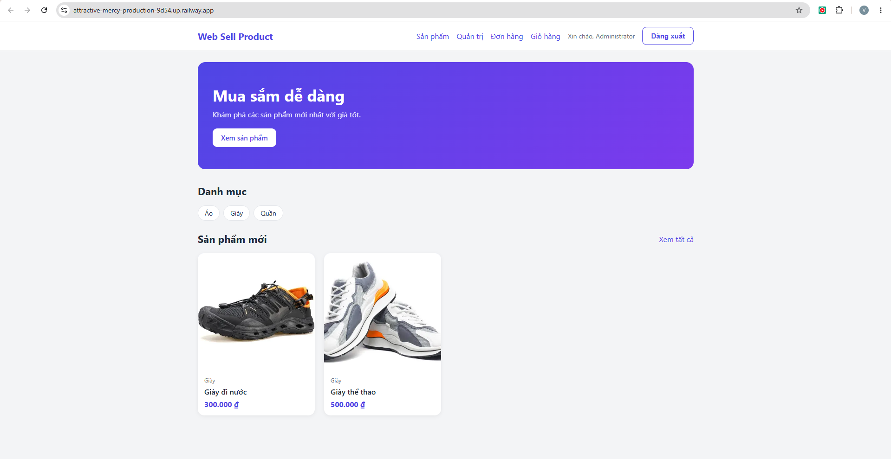
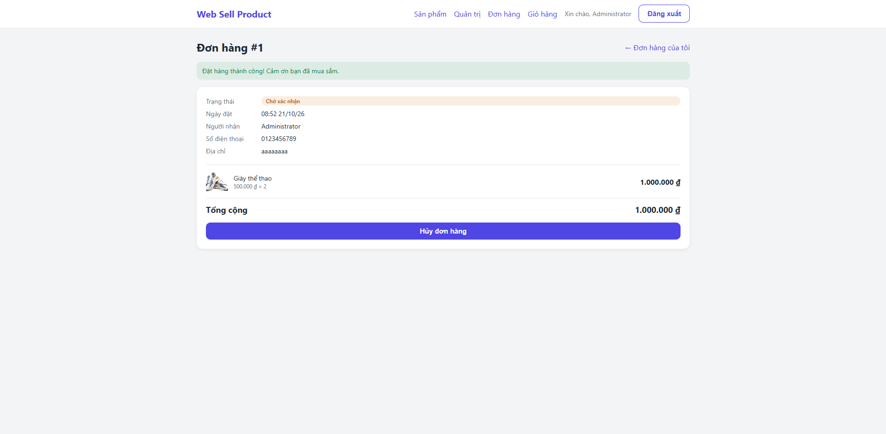
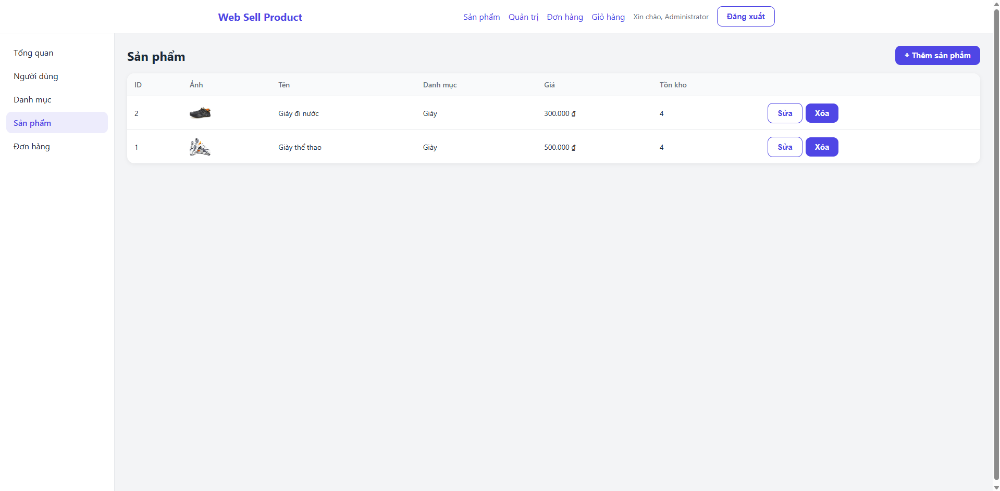
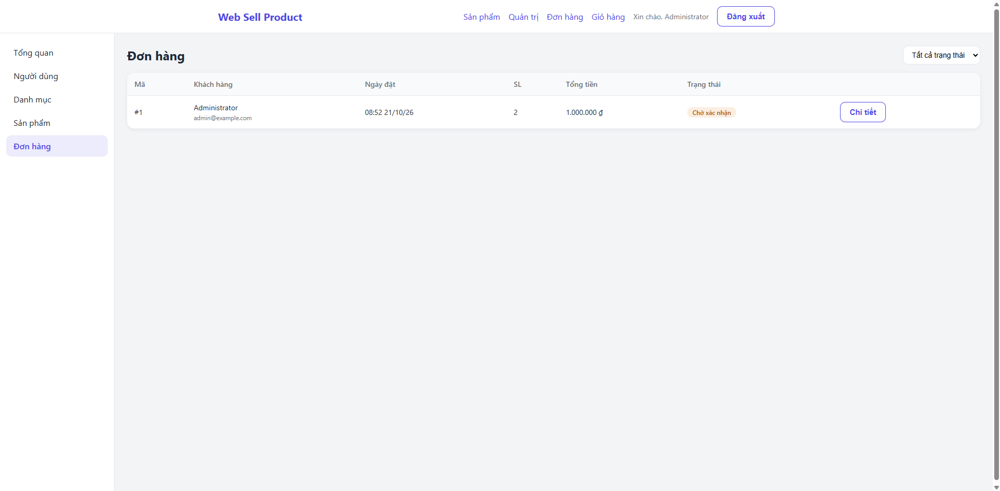
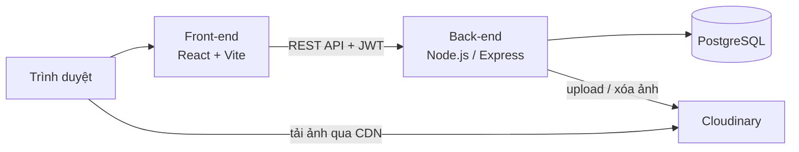
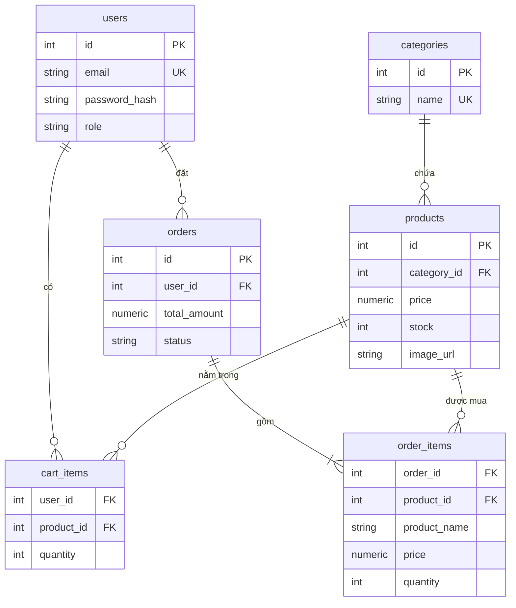

# 🛒 Web Sell Product

Website thương mại điện tử full-stack gồm **trang mua sắm** cho khách hàng và **trang quản trị** cho admin.
Front-end **ReactJS**, back-end **Node.js/Express** (RESTful API), cơ sở dữ liệu **PostgreSQL**, ảnh lưu trên **Cloudinary**, triển khai trên **Railway**.

🔗 **Demo:** https://attractive-mercy-production-9d54.up.railway.app

**Tài khoản demo:**

| Vai trò | Email | Mật khẩu |
|---|---|---|
| Khách hàng | demo@example.com | 123456 |

## 📸 Ảnh chụp màn hình

| Trang chủ | Đặt hàng thành công |
|---|---|
|  |  |

| Quản lý sản phẩm | Quản lý đơn hàng |
|---|---|
|  |  |

## ✨ Tính năng

**Khách hàng**
- Đăng ký, đăng nhập (JWT)
- Xem sản phẩm: tìm theo tên, lọc theo danh mục, phân trang
- Giỏ hàng lưu trên server, kiểm tra tồn kho khi thêm hoặc đổi số lượng
- Thanh toán (COD): nhập thông tin giao hàng và đặt hàng
- Xem lịch sử, chi tiết đơn hàng, hủy đơn khi đơn còn chờ xác nhận

**Quản trị (Admin)**
- Dashboard thống kê người dùng, danh mục, sản phẩm, đơn hàng
- CRUD người dùng, danh mục, sản phẩm
- Upload ảnh sản phẩm lên Cloudinary, có xem trước
- Quản lý đơn hàng: lọc theo trạng thái, chuyển trạng thái theo quy trình

## 🛠 Công nghệ

| Phần | Công nghệ |
|---|---|
| Front-end | React 19, Vite, React Router 7, Context API, Axios, SCSS |
| Back-end | Node.js, Express 5, `pg` (SQL thuần, không ORM) |
| Cơ sở dữ liệu | PostgreSQL |
| Bảo mật | JWT, bcrypt, Helmet, CORS, express-rate-limit |
| Lưu trữ ảnh | Multer, Cloudinary |
| Triển khai | Railway (front-end, back-end, PostgreSQL) |

## 💡 Điểm kỹ thuật nổi bật

### Đặt hàng an toàn khi nhiều người mua cùng lúc
Toàn bộ quá trình đặt hàng chạy trong **một transaction** (xem [`orderModel.js`](back_end/src/models/orderModel.js)):

1. `SELECT … FOR UPDATE` khóa các dòng giỏ hàng và sản phẩm. Request khác muốn mua cùng sản phẩm phải chờ transaction này xong.
2. Kiểm tra tồn kho, sau đó tạo đơn, lưu chi tiết đơn, trừ kho và xóa giỏ hàng.
3. Bước nào lỗi thì `ROLLBACK` toàn bộ, nên không xảy ra trường hợp đã trừ kho mà không có đơn.

Kết quả: không bán vượt tồn kho. Nếu một người bấm "Đặt hàng" hai lần cùng lúc thì chỉ tạo ra một đơn.
Hủy đơn cũng chạy trong transaction để hoàn lại tồn kho đúng một lần.

### Trạng thái đơn hàng theo quy trình
```
pending ──► confirmed ──► shipping ──► completed
   │            │
   └────────────┴──► cancelled (hoàn lại tồn kho)
```
Back-end chặn mọi chuyển trạng thái sai quy trình, ví dụ `pending → shipping` hoặc hủy đơn đang giao.

### Lưu thông tin đơn hàng tại thời điểm mua
`order_items` lưu lại tên, giá, ảnh lúc mua. Sau này admin sửa giá hoặc xóa sản phẩm thì đơn cũ vẫn giữ nguyên.

### Bảo mật
- Mật khẩu băm bằng **bcrypt**. Đăng nhập sai email hay sai mật khẩu đều trả về cùng một thông báo, để không lộ email nào đã đăng ký.
- **Rate limit:** đăng nhập sai tối đa 10 lần / 15 phút, đăng ký tối đa 10 tài khoản / giờ cho mỗi IP.
- Mỗi request đều đọc lại user từ database, nên khi user bị xóa hoặc đổi quyền thì token cũ hết tác dụng ngay.
- Truy vấn SQL đều tham số hóa, chống SQL Injection.
- Lỗi PostgreSQL (trùng dữ liệu, khóa ngoại…) được chuyển thành mã HTTP phù hợp trong middleware xử lý lỗi tập trung.

### Upload ảnh
Multer nhận file vào RAM (giới hạn 5MB, chỉ nhận ảnh) rồi đẩy thẳng lên Cloudinary. Cloudinary tự thu nhỏ ảnh về tối đa 1200px, chuyển sang **WebP** và phân phối qua CDN.
Khi admin đổi ảnh hoặc xóa sản phẩm, ảnh cũ trên Cloudinary cũng bị xóa. Riêng ảnh mà đơn hàng cũ còn dùng thì được giữ lại.

## 🏗 Kiến trúc



Back-end tổ chức theo mô hình **Routes → Controllers → Models**:

```
back_end/
├── database/        schema.sql, setup.js (tạo bảng + admin đầu tiên)
└── src/
    ├── config/      kết nối PostgreSQL, Cloudinary
    ├── routes/      khai báo endpoint + middleware phân quyền
    ├── controllers/ kiểm tra dữ liệu đầu vào, xử lý nghiệp vụ
    ├── models/      truy vấn SQL
    ├── middlewares/ auth (JWT), rate limit, upload
    └── utils/
front_end/src/
├── api/             axios (tự gắn token)
├── context/         AuthContext, CartContext
├── components/      Navbar, ProtectedRoute, Modal, ...
├── pages/           trang khách hàng + pages/admin
└── styles/          SCSS
```

## 🗄 Cơ sở dữ liệu



## 📡 API

| Method | Endpoint | Quyền | Mô tả |
|---|---|---|---|
| POST | `/api/auth/register` | Công khai | Đăng ký |
| POST | `/api/auth/login` | Công khai | Đăng nhập, trả về JWT |
| GET | `/api/auth/me` | Đăng nhập | Thông tin tài khoản hiện tại |
| GET | `/api/products` | Công khai | Danh sách (`search`, `category_id`, `page`, `limit`) |
| GET | `/api/products/:id` | Công khai | Chi tiết sản phẩm |
| POST/PUT/DELETE | `/api/products[/:id]` | Admin | Thêm / sửa / xóa sản phẩm |
| GET | `/api/categories[/:id]` | Công khai | Danh mục |
| POST/PUT/DELETE | `/api/categories[/:id]` | Admin | Thêm / sửa / xóa danh mục |
| GET/POST/DELETE | `/api/cart` | Đăng nhập | Xem / thêm / xóa toàn bộ giỏ hàng |
| PUT/DELETE | `/api/cart/:productId` | Đăng nhập | Đổi số lượng / xóa một sản phẩm |
| POST | `/api/orders` | Đăng nhập | Đặt hàng từ giỏ |
| GET | `/api/orders/my` | Đăng nhập | Đơn hàng của tôi |
| GET | `/api/orders/:id` | Chủ đơn / Admin | Chi tiết đơn |
| PATCH | `/api/orders/:id/cancel` | Chủ đơn | Hủy đơn đang chờ xác nhận |
| GET | `/api/orders` | Admin | Tất cả đơn (`status`, `page`) |
| PATCH | `/api/orders/:id/status` | Admin | Chuyển trạng thái đơn |
| POST | `/api/uploads/image` | Admin | Upload ảnh (form-data, field `image`) |
| GET/POST/PUT/DELETE | `/api/users[/:id]` | Admin | Quản lý người dùng |

## 🚀 Chạy trên máy

**Yêu cầu:** Node.js 22+, PostgreSQL, tài khoản Cloudinary (miễn phí).

```bash
git clone https://github.com/binhdztv001/web-sell-product.git
cd web-sell-product

# Back-end
cd back_end
npm install
cp .env.example .env      # điền thông tin PostgreSQL, JWT_SECRET, Cloudinary, admin
npm run db:setup          # tạo database, bảng và tài khoản admin
npm run dev               # http://localhost:5000

# Front-end (mở terminal khác)
cd front_end
npm install
npm run dev               # http://localhost:5173
```

Khi chạy local, front-end gọi `/api` qua proxy của Vite nên không cần cấu hình gì thêm.

### Biến môi trường (back_end/.env)

| Biến | Ý nghĩa |
|---|---|
| `DATABASE_URL` *hoặc* `DB_HOST`, `DB_PORT`, `DB_USER`, `DB_PASSWORD`, `DB_NAME` | Kết nối PostgreSQL |
| `JWT_SECRET`, `JWT_EXPIRES_IN` | Ký token đăng nhập |
| `CLIENT_URL` | Domain front-end được phép gọi API (CORS) |
| `CLOUDINARY_CLOUD_NAME`, `CLOUDINARY_API_KEY`, `CLOUDINARY_API_SECRET` | Lưu ảnh |
| `ADMIN_EMAIL`, `ADMIN_PASSWORD`, `ADMIN_NAME` | Tài khoản admin tạo khi chạy `db:setup` |

## ☁️ Triển khai (Railway)

Một project Railway gồm 3 service:

| Service | Root Directory | Cấu hình |
|---|---|---|
| PostgreSQL | — | Database do Railway cung cấp |
| Back-end | `/back_end` | Pre-deploy: `npm run db:setup`. Biến: `DATABASE_URL=${{Postgres.DATABASE_URL}}` và các biến ở bảng trên |
| Front-end | `/front_end` | Biến `VITE_API_URL=https://<domain-back-end>` (nhúng vào lúc build). `npm start` phục vụ bản build bằng `serve`, có hỗ trợ tải lại trang ở mọi đường dẫn |

`db:setup` chạy lại nhiều lần vẫn an toàn, và tự thử kết nối lại khi database chưa sẵn sàng lúc deploy.

## 👤 Tác giả

**Trần Văn Bình** · [github.com/binhdztv001](https://github.com/binhdztv001) · tranvanbinh10a3nh1@gmail.com
